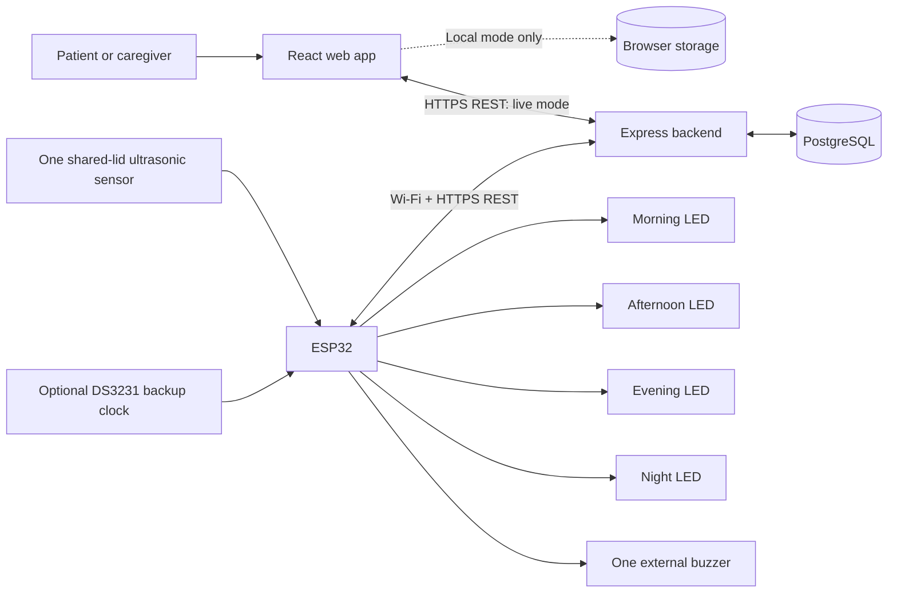

# 4. System architecture

## 1. What SmartMed does

SmartMed helps a patient follow a prescribed daily medicine routine. A caregiver fills four labelled sections—Morning, Afternoon, Evening, Night—inside one box with **one shared lid**. Several medicines can belong to the same section.

At each scheduled time, the matching LED blinks and one external buzzer sounds. The web app shows medicine names, strengths, quantities, and instructions. One ultrasonic sensor detects the shared lid opening and closing.

**A box opening is an access record.** It cannot prove which section was used, which medicine was selected, how many pills were removed, or whether medicine was swallowed. The software does not prescribe or recommend medicines. Refilling is manual and daily.

## 2. Implementation status

| Component | Current status |
| --- | --- |
| React/Vite frontend | Implemented: account creation/sign-in, Today with four visible sections and inline schedule editing, paginated History |
| Express backend and PostgreSQL | Implemented: migrations, patient-scoped APIs, transactional writes, persistent sessions and history |
| Patient authentication | Implemented: salted scrypt password hashes, HttpOnly cookies, CSRF/origin checks, throttled login, logout and expiry |
| Active-dashboard popups | Implemented: focused/visible dashboard, real schedule, dismiss and five-minute snooze |
| Device API and provisioning | Implemented: per-box credentials, calibration, configuration/versioned reminders, idempotent event ingestion, heartbeat |
| ESP32 firmware starter | Included under `firmware/SmartMed`; cloud compilation blocked by PlatformIO registry policy; physical testing/calibration outstanding |
| Docker/dev setup | PostgreSQL Compose service, generated private settings, migrations, API/frontend development command, runtime Dockerfile |
| Separate caregiver delegation | Not implemented; the current account/workspace belongs to one patient |
| Email/SMS alerts and emailed recovery | Not implemented; use the in-app reminder and operator password-reset tool |

The application creates no default patients, prescriptions, or opening events. Live mode is the default and uses PostgreSQL. Explicit `VITE_DATA_MODE=local` remains an optional browser-only schedule, without authentication or device events. In-app popups do not confirm intake. Backend tests and protocol fixtures cannot certify physical sensing or medicine safety.

## 3. Architecture diagram

The web/API/database path is implemented and tested. The hardware path requires provisioning, verified firmware compilation, and physical calibration/testing.

The browser calls the backend, not the ESP32. The ESP32 initiates outbound requests, so it does not need a public IP address or an exposed inbound port. Neither the browser nor firmware connects directly to PostgreSQL. MQTT is unnecessary for the initial version.

## 4. Responsibilities

| Layer | Responsibility |
| --- | --- |
| Patient/caregiver | Enter the prescription accurately, load/refill labelled sections, follow the displayed list |
| Web app | Display Today, edit schedules, show received box history; keep diagnostics out of patient screens |
| Backend | Authenticate users/devices, authorize access, validate writes, generate dated reminders, store/deduplicate events, provide history |
| Database | Preserve schedules, historical reminder instances, physical events, device bindings, and audit information |
| ESP32 | Keep time, cache reminders, read the lid sensor, drive LEDs/buzzer, persist and upload events |
| Sensor | Supply measurements for calibrated whole-lid state detection; not identify medicine selection |

## 5. Data flow

### A. Saving a schedule

1. Caregiver adds a prescribed medicine to a daily section and chooses its reminder time.
2. In local mode, the app saves it only in that browser.
3. In live mode, the backend atomically saves the medicine and the section's shared reminder time in PostgreSQL.
4. Backend generates dated reminder instances with stable IDs and UTC timestamps.
5. ESP32 downloads a versioned upcoming-reminder snapshot and saves it persistently.

Changing a section's time affects all medicines in that section. Multiple medicines in one section do not require separate LEDs or separate sensor channels.

### B. Reminder and physical access

1. At reminder time, ESP32 blinks the appropriate section LED and sounds the shared buzzer.
2. Patient reads the scheduled list and follows the matching compartment label.
3. A stable sensor CLOSED → OPEN transition creates a `BOX_OPENED` event; a stable close creates `BOX_CLOSED`.
4. Firmware saves each event durably and uploads it to the backend.
5. Backend validates device identity, commits each unique event once, and acknowledges it.
6. Backend may attach reminder timing context; it does not claim the listed medicines were taken.
7. The web app's next refresh shows the received history. Live refresh runs every 10 seconds.

Opening outside a reminder window remains an ordinary box event. A lid already open at startup is a state report, not proof of a new opening.

## 6. Minimal backend data model

Implemented tables are created through checksum-tracked SQL migrations in `server/migrations/`.

| Entity | Key information |
| --- | --- |
| `patients` | Email, password hash, display name, timezone, and current schedule version |
| `sessions`, `auth_limits` | Hashed opaque sessions, CSRF token/expiry, durable authentication rate counters |
| `slots` | Patient/workspace, one of four fixed slot IDs, configured local time or null |
| `medicines` | Slot, name, strength, quantity, instructions; entered from prescription |
| `schedule_versions` | Immutable prescription snapshots with validity intervals for late/offline event association |
| `reminders` | Stable ID, slot, schedule version, UTC scheduled/window-end timestamps |
| `devices` | Assigned workspace, credential binding, last heartbeat, configuration/schedule versions |
| `box_events` | Unique device/event identity, OPENED/CLOSED type, occurrence/receipt timestamps, sequence, optional immutable reminder context |

Keep recurring schedules separate from dated access records. Yesterday's event must not mark today's reminder as accessed. Preserve historical context after a medicine is edited or removed. Enforce a unique `(device_id, event_id)` constraint to make upload retries safe.

## 7. Connectivity, timing, and failure behavior

- Use the patient's actual IANA timezone for the live schedule, UTC timestamps in storage/transmission, and the browser timezone for local-only schedules.
- ESP32 reminders run from a persisted schedule and valid clock, even when Wi-Fi is unavailable. The optional RTC preserves time, not power to the whole box.
- Queue events across restarts; delete them only after backend acknowledgment. Retry failed uploads with backoff.
- Missing echoes are invalid sensor readings unless a reliable detection method establishes otherwise. Report monitoring gaps instead of inventing openings.
- A heartbeat does not prove a past offline period had no openings. Any future missed-opening logic needs reconciled event coverage; the current UI makes no missed-dose or intake conclusions.
- Expired schedules, invalid clocks, or sensor faults must remain visible to system operators. Do not silently fabricate successful monitoring.
- Live API errors preserve the last received view with an error, or an unavailable state on first load. They never fall back to synthetic records.
- Local and live storage are separate. There is no implemented automatic migration from local browser schedules to the backend.

## 8. Deployment boundary

For a real deployment, serve the frontend and API through HTTPS, preferably on the same origin. The Express implementation includes patient authentication/authorization, CSRF/session checks, durable storage, and device provisioning. Complete the deployment-specific TLS configuration, database backups, access review, and physical acceptance tests before real use. Separate caregiver roles and email/SMS providers are outside the implemented scope.

Device credentials belong in controlled firmware/backend provisioning, never in browser variables, Git, or URLs. The web app should continue to expose only routine management and box history; calibration and firmware diagnostics belong in protected operator tooling.

## 9. Bring-up order

1. Run PostgreSQL, migrations, Express, and React using the application guide.
2. Create a real patient account and enter the prescribed schedule.
3. Test the shared-lid sensor in the actual enclosure before choosing thresholds.
4. Provision a box credential, save measured calibration, and configure the firmware's HTTPS trust and network settings.
5. Compile/upload the starter and verify **physical lid opening → committed PostgreSQL event → web history**.
6. Verify local LED/buzzer reminders, offline recovery, power loss, queue limits, schedule updates, and revoked credentials.

Automated backend checks already exercise patient isolation, CSRF/origin checks, real session login/logout, atomic schedules, stable reminder IDs, token rotation/revocation, duplicate/conflicting batches, historical prescription context, and pagination against PostgreSQL. Browser checks exercise real account/schedule/history persistence. Physical hardware acceptance remains separate.

Detailed steps: [Microcontroller integration](02_MICROCONTROLLER_INTEGRATION.md), [Hardware connections](03_HARDWARE_CONNECTIONS.md), and [Run the application](01_RUN_APPLICATION.md).
